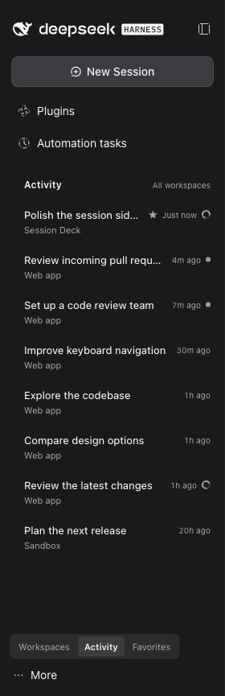
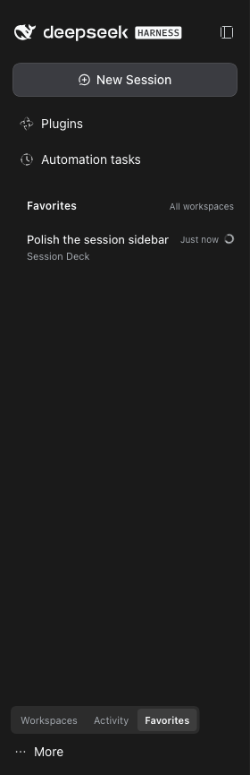
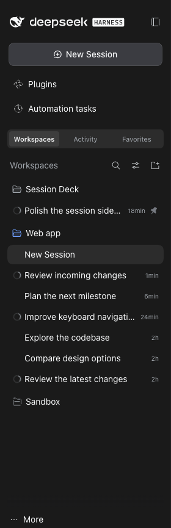

# DSH Session Deck

[简体中文](https://github.com/yiliang114/dsh-session-deck/blob/main/README.zh-CN.md)

**Keep track of work across DSH workspaces without leaving your conversation.** Session Deck adds Activity and Favorites views to the native DeepSeek Harness sidebar, so you can spot running agents, reply to waiting sessions, and return to completed results.

A community plugin with an English interface, no extra npm dependencies, and no telemetry. Licensed under [MIT](LICENSE).

## Three views, one sidebar

| View | What it helps you do |
| --- | --- |
| **Activity** | Follow running, waiting, unread, and recent sessions across all workspaces. |
| **Favorites** | Keep important sessions close using DSH's native pinned sessions. |
| **Workspaces** | Return to the native workspace tree, its management tools, and other plugins' menus. |

Switching views keeps your current conversation open. Session rows show the title, workspace, time, and status; their menus provide favorite, rename, fork, archive, and copy-ID actions.

*Screenshots captured from a local DSH installation in English; session titles and workspace names anonymized.*

| Activity | Favorites | Workspaces |
| --- | --- | --- |
| Follow active work and unread results. | Return to native pinned sessions. | Keep the complete workspace controls. |
|  |  |  |

Screenshots show the unmodified DSH sidebar, with the view switcher at the bottom. Browser menus, tabs, and the address bar are excluded.

## Install locally

**The npm package has not been published. Use a local checkout or tarball today.** The package name is **`@yiliang114/dsh-session-deck`**.

Requirements:

- Node.js **22 or newer**.
- DSH Web GUI **0.2.1-rc.2**. This is the exact supported host version; other versions are unverified.
- DSH's native sidebar, session, and workspace plugins enabled.

```sh
git clone https://github.com/yiliang114/dsh-session-deck.git
cd dsh-session-deck
npm run verify
dsh plugin --profile web add "link:$PWD" --offline --ignore-scripts
```

There are no dependencies to install. The repository includes the client bundle; `build` checks JavaScript syntax rather than generating it. Replace `web` if you use another profile. Keep the checkout in place while using a linked installation.

You can also install through **Plugins → Add plugin → Install a third-party plugin**: enter `link:/absolute/path/to/dsh-session-deck`, choose **Install**, then **Enable now**, and refresh the page.

The plugin's own labels are English. To make the rest of DSH English too, use **More → Settings → General → Language → English**. Session titles remain in the language you wrote them.

Refresh your existing DSH GUI, then choose **Workspaces / Activity / Favorites** in the sidebar. On an unmodified DSH installation, the switcher appears at the bottom; the [optional sidebar patch](#optional-place-the-switcher-above-the-list) moves it above the list. Refresh after client changes too; hot reload is not assumed.

If you installed an earlier local version of this plugin, disable and remove it in DSH's plugin manager first to avoid two instances controlling the sidebar. You can keep its browser storage.

### Install from a tarball

To distribute the plugin without npm, run from the checkout:

```sh
npm run verify
npm pack --ignore-scripts
```

Copy the generated archive to the target machine, then install using its absolute path:

```sh
dsh plugin --profile web add /absolute/path/yiliang114-dsh-session-deck-0.1.0.tgz --ignore-scripts
```

Refresh the GUI. A tarball installation does not depend on the original checkout and does not apply the optional host patch automatically.

### Future npm and market availability

**Only after version 0.1.0 is published and verified**, this command will become usable:

```sh
dsh plugin --profile web add @yiliang114/dsh-session-deck@0.1.0 --ignore-scripts
```

The [market index](market-index.json) currently contains `plugins: []`: there are **no released entries**, so adding the index will not display this plugin. DSH's custom plugin market uses user-added index sources; npm publication does not automatically collect or list a plugin in an official DSH market.

After a confirmed release is added to the index, its direct URL can be added through DSH's custom plugin market:

```text
https://raw.githubusercontent.com/yiliang114/dsh-session-deck/main/market-index.json
```

Maintainers: see the [release guide](https://github.com/yiliang114/dsh-session-deck/blob/main/docs/releasing.md) for npm bootstrap, OIDC configuration, and index updates.

## How session status works

- **Activity keeps all running, waiting, and unread sessions**, plus at most **20 ordinary recent sessions**, sorted by DSH's `updatedAt` rather than last-opened time. Favorites has no 20-session limit.
- Favorites are **native DSH pins**, shared with the workspace tree. Archived, subagent, and empty sessions are omitted from the lists; ordinary forks remain visible.
- Status priority is **waiting for a reply → running → unread**. A parent remains running while any known subagent descendant is running; ordinary forks do not propagate status to their source.
- Aggregation covers only descendants known to DSH's session directory. **Independent background shell jobs are not tracked**: an idle session does not mean every process it launched has exited.
- A session becomes unread when it and its known descendants finish while you are viewing something else. Opening it clears the marker. Persisted observations can recover completions across a refresh, but cannot reconstruct work that started and finished while every page was closed or was never observed.
- Archiving an active session requires a **Stop and archive** confirmation. There is no permanent-delete action. Switch to Workspaces for the complete native menus, including actions from other plugins.

## DSH compatibility and switcher position

Version compatibility and switcher placement are separate checks. This plugin declares an exact `engines.dsh` match of **0.2.1-rc.2**; a bottom-position switcher on that version does not indicate an outdated plugin or a version mismatch.

| DSH sidebar | `sidebar.workspaces.before` | Session Deck support |
| --- | --- | --- |
| Official **0.2.1-rc.2** | Absent; the switcher falls back to the footer. | Verified in the real GUI. |
| **0.2.1-rc.2** with the local patch below | Added after global panels, including Automation tasks. | Accepted by the version-checked patch script. |
| Official **0.2.1-rc.3** | Still absent in its published client and slot contract. | Full plugin compatibility is unverified; excluded by the current engine declaration. |

The rc.3 published files were inspected on **2026-10-23**. Upgrading to rc.3 alone does not provide the missing slot. The patch is a local modification to DSH, not an official update or a step automatically performed by plugin installation. Supporting another host version requires validating its session, workspace, slot, and UI APIs before widening `engines.dsh` or the patch script's version guard.

## Optional: place the switcher above the list

DSH 0.2.1-rc.2 does not expose an official slot at this position. The [sidebar patch script](scripts/patch-sidebar-before.mjs) adds a local `sidebar.workspaces.before` slot after the global panel entries and before the workspace area. **The plugin works without this patch**, using the bottom position as its fallback.

Locate the `@deepseek-ai/dsh-client-ui-sidebar` package actually used by your running DSH. From this repository, replace the placeholder with that package's directory, not the DSH root or this plugin directory:

```sh
node scripts/patch-sidebar-before.mjs /path/to/dsh-client-ui-sidebar
node --check /path/to/dsh-client-ui-sidebar/lib/client.js
```

The script accepts only **0.2.1-rc.2**, checks both target files before writing, and saves adjacent `.dsa-before.backup` files. It is safe to rerun and rejects unexpected code. Refresh the GUI after applying it.

To restore the original sidebar:

```sh
node scripts/patch-sidebar-before.mjs /path/to/dsh-client-ui-sidebar --rollback
```

Rollback needs the original backups and refuses to overwrite unrelated changes. Refresh again to return to the bottom position. DSH reinstalls or upgrades may replace the patch; check compatibility before reapplying it. If you modify a DSH source checkout, rebuild the affected client artifacts as well.

## Privacy and local storage

Session Deck uses DSH's session and workspace APIs. It makes **no model calls, sends no telemetry, and has no external upload endpoint**.

Browser `localStorage` retains the original keys for compatibility:

| Key | Stored data |
| --- | --- |
| `dsh-session-activity.mode.v1` | Selected view. |
| `dsh-session-activity.pending.v1` | Session IDs, observed running state, and completion/unread metadata. |

No conversation bodies are stored by the plugin. Favorites remain in DSH's native pinned data. View and unread state sync between tabs on the same origin, not across devices. If storage is unavailable, state stays in memory. Clearing browser storage resets this metadata; processed records are capped at 1,000, while running and unread records are retained.

Disable or remove **`@yiliang114/dsh-session-deck`** in DSH's plugin manager to stop using it. Removal does not clear browser storage or undo the optional host patch; use the rollback command separately.

## Development

```sh
npm run verify
```

This runs syntax checks, Node.js tests for session selection and state handling, and a dry-run package-content check. CI runs it on Node.js 22 and 24. There is no separate lint or TypeScript check, and automated checks do not replace testing the real DSH GUI.

The client lives in [lib/client.js](lib/client.js), with a minimal [host entry](src/host.mjs) and [Cordis configuration](cordis.patch.yml). Report bugs with your DSH version, installation method, and reproduction steps in [GitHub Issues](https://github.com/yiliang114/dsh-session-deck/issues).

## License

[MIT](LICENSE). Independently maintained; not an official built-in DSH component.
